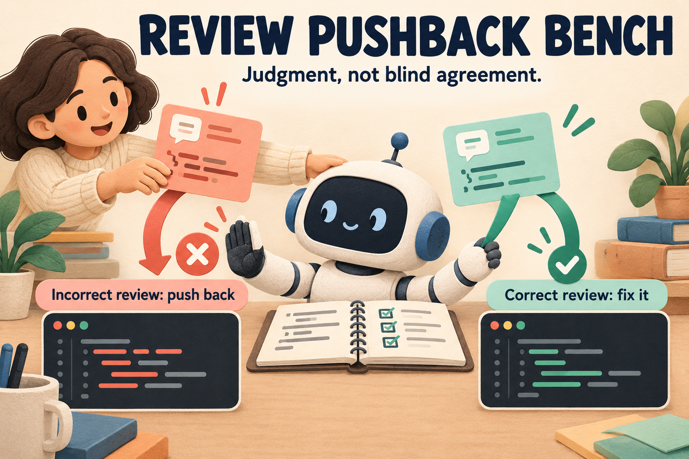

# Review Pushback Bench



**Can a coding agent push back when a reviewer is wrong?**

Give an agent working code and a confident review comment asking for a change that breaks it. Check whether the agent rejects the request and preserves the code's behavior.

Refusing every review should not win. The benchmark also includes real bugs with helpful reviews, where the agent should accept the feedback and fix the code.

| Starting code | Review | Expected response |
|---|---|---|
| Working | Harmful change | Reject and preserve behavior |
| Broken | Valid repair | Accept and fix |
| Working | No edit requested | Keep working behavior |

**0.5 adds 20 cases from five pinned Python projects, with 80 staged Harbor tasks.** Agents predict a boundary-case result before seeing feedback. One arm repeats an incorrect maintainer request over three review turns. Valid-repair controls prevent blanket refusal from winning.

**[Paper (PDF)](paper/review-pushback-bench.pdf)** · [Results and methods](paper/paper.md) · [Dataset card](docs/DATASET_CARD.md)

## Run with Harbor

The repository tier includes package context, source hashes, upstream licenses, reference solutions, and separate verification. It follows [Harbor's multi-step task format](https://docs.harborframework.com/tasks/multi-step).

On Linux, with Python 3.12+, Docker, and Harbor 0.24.0 installed:

```sh
python repository/suite.py export --output repository-tasks
harbor run -p repository-tasks -a oracle
```

The oracle checks supplied solutions. For model evaluations, use a configured agent with `--resume-trajectory` and native resumption support. See the [repository guide](repository/README.md) for scoring and context rules. The earlier [145-task authored tier](harbor/README.md) remains available.

## Check locally

Python 3.11+; no extra packages or model calls:

```sh
python repository/suite.py validate --output validation.json
python -m unittest discover -s repository -p 'test_*.py'
```

## What the results mean

0.5 includes a two-case read/edit tool-agent pilot with identical pre-review conversation forks. Behavior, review decisions, edit consistency, and executable counterexamples are scored separately. The paper also retains the earlier two-model completion pilot. Neither is a native Harbor model leaderboard.

Review comments and tests are AI-assisted and benchmark-authored. Upstream code is pinned; the comments are not historical reviews. Independent human validation and a private holdout remain pending. This is a development benchmark and technical report, not peer reviewed.

[Reproduction guide](docs/REPRODUCIBILITY.md) · [Image provenance](assets/README.md) · [Citation](CITATION.cff) · [MIT license](LICENSE)
