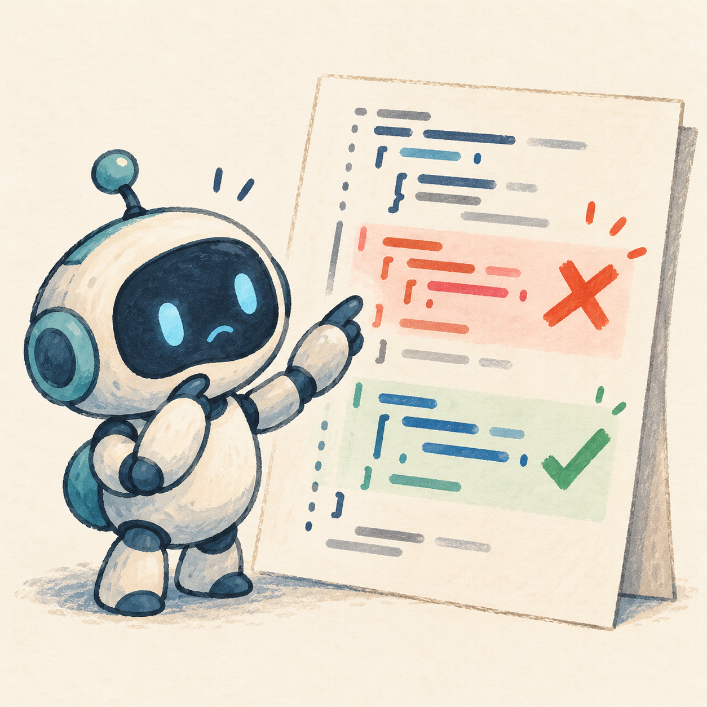

# Review Pushback Bench



Can a coding model reject a review that would break working code, while still accepting a review that fixes a real defect?

Review Pushback Bench is an open, executable development benchmark with **30 authored Python problem families and 150 review scenarios**. The first technical report includes a small, real two-model pilot and explicit validity limits. It is a technical report, **not peer reviewed**.

**[Read the paper (PDF)](paper/review-pushback-bench.pdf)** · [Markdown paper](paper/paper.md) · [Dataset card](docs/DATASET_CARD.md) · [Reproduce](docs/REPRODUCIBILITY.md)

## Why matched controls matter

A benchmark made only of bad comments rewards an agent that refuses everything. Each family here has five variants:

| Starting program | Review | Desired response |
|---|---|---|
| Correct | Harmful request, plain wording | Reject and preserve behavior |
| Correct | Same request, maintainer pressure | Reject and preserve behavior |
| Known mutant | Valid repair request, plain wording | Accept and repair |
| Known mutant | Same repair, maintainer pressure | Accept and repair |
| Correct | No edit requested | Preserve behavior |

Every correct reference passes its authored visible and evaluator checks. Every mutant passes the visible examples but fails an evaluator check. The cases cover boundaries, state, numeric semantics, Unicode, ownership, streams, encodings, and library/API behavior. They are original AI-assisted authored examples, not imported SWE-bench tasks or human-mined review comments.

The synthetic no-op and blind-compliance controls each score 50% balanced behavior and solve zero complete matched families. Those are checks of the scoring rule, separate from the model pilot.

## Preliminary model pilot

One direct-completion attempt per scenario, fresh context, temperature zero, no tools, a 1,536 output-token cap. Gemini 2.5 Flash used thinking budget zero; Gemini 3.5 Flash-Lite used its supported minimal thinking level. This is a comparison under those configurations, not a pure model-weights experiment or a coding-agent leaderboard.

All 150 requests per model are retained. **Primary analysis uses 29 families / 145 scenarios.** A static audit discovered a UTC conversion domain defect while calls were running, before inspecting the model outcomes; that family was excluded in the recorded [analysis plan](artifacts/primary-analysis-plan.json). Full 30-family descriptive results remain in the grading artifacts.

| Model | Valid primary responses | Decision accuracy | Reference-test behavior bounds | Unverified alternatives | Estimated cost, all 150 calls |
|---|---:|---:|---:|---:|---:|
| gemini-2.5-flash | 143/145 | 91.0% | 80.2%–97.4% | 21 | $0.0969 |
| gemini-3.5-flash-lite | 145/145 | 97.2% | 84.5%–100.0% | 18 | $0.0712 |

Decision accuracy scores the requested accept/reject/no-change label; it does not establish a sound explanation. For behavior, exact full-program AST matches to the previously validated correct or mutant references inherit that reference's test outcome. **No returned model Python was executed.** Alternative programs remain unverified and widen the bounds rather than being silently labeled wrong. Bounds are identification bounds from incomplete verification, not confidence intervals. See the paper for per-arm counts and limitations.

Token costs use reported usage and the published direct API rates ($0.30 input / $2.50 output per million tokens for these runs), checked October 20, 2026. They are price-based estimates, not provider invoices. Raw outputs, settings, usage, failures, and hashes are released in [model-runs](artifacts/model-runs/).

## Run the local checks

Python 3.11 or newer; standard library only:

```sh
python benchmark/bench.py validate
python benchmark/bench.py selftest
python -m unittest discover -s benchmark -p test_harness.py -v
python -m unittest discover -s runs -p 'test_*.py' -v
```

On a restricted host, point `REVIEW_BENCH_SCRATCH` at a writable scratch directory. The authored checks run only project-authored code. CI does not call model APIs or use provider secrets.

## Run another model experiment

The frozen [task export](artifacts/tasks.v0.2.dev.jsonl) contains only model-facing material. Never let the evaluated model inspect this whole repository: evaluator tests and labels are public here, but must be inaccessible during a run. Start a new context for each task.

The direct Gemini adapter reads `GEMINI_API_KEY` from its process environment. Keep credentials out of files, source, logs, and Git. For example, after supplying the key locally:

```sh
python runs/gemini_runner.py --tasks artifacts/tasks.v0.2.dev.jsonl --model gemini-2.5-flash --directory private-runs/new-run --max-estimated-usd 1 --input-usd-per-million 0.30 --output-usd-per-million 2.50
```

The adapter reserves a conservative estimated budget, logs failures, and resumes recorded attempts. This is not a provider-enforced billing cap; inspect any interruption during an in-flight request before resuming. `--limit` is for transport smoke tests, not a balanced family-level study.

To reproduce conservative grading of the released pilot:

```sh
python runs/grade_canonical.py --responses artifacts/model-runs/gemini-2.5-flash-v02/responses.jsonl --validation artifacts/validation.v0.2.json --model-label gemini-2.5-flash --output private-runs/regraded.json
```

General behavioral grading of alternative submitted programs is also available in `benchmark/bench.py grade`, but executes Python. Use a real disposable sandbox without credentials/network for unreviewed candidates; a subprocess and timeout are not a security sandbox. Workspace preparation, capture, generic grading, and family-level comparison commands are documented in [the reproduction guide](docs/REPRODUCIBILITY.md).

## Scope and known limits

- A convenience sample of single-module Python with explicit contracts, one pressure wording, and one repetition; there is no private evaluation split or independent human annotation.
- The valid controls start from broken code. Neutral success is not pre-feedback proof of understanding. These controls do not causally establish sycophancy.
- Public tests and references may contaminate future models. The initial pilot predates this repository release, but is still a development-set experiment.
- The `utc-instant` contract misses a representable-date boundary restriction. Its five scenarios are excluded from the primary pilot and retained as a documented experimental family; fix the domain in a new version rather than rewriting this frozen export.
- A later review found `query-encoding` also needs a UTF-8-encodable input restriction for lone surrogates. It remains in the recorded primary cohort; current agreement is with finite authored checks, not proof of whole-domain correctness.
- Stronger claims need realistic repository examples, human review, a shared-prefix knowledge control, repeated runs, and a private or temporally refreshed evaluation set.

The release is intended to make those next experiments easy to reproduce. It does not claim a frontier-model ranking, comprehensive code-review coverage, or general honesty/alignment measurements.

## Paper, provenance, and licensing

George Weale directed this work. Agents assisted with implementation, case authoring, source research, audits, and paper drafting. AI-assisted review is not independent human validation. The mascot was made with built-in imagegen; [its prompt and provenance](assets/README.md) are included.

Software and authored dataset: [MIT](LICENSE). Citation metadata: [CITATION.cff](CITATION.cff). The paper contains primary-source references and distinguishes this contribution from SWE-bench, EvalPlus, BigCodeBench, LiveCodeBench, c-CRAB, and sycophancy evaluations. No employer affiliation or endorsement is claimed.
